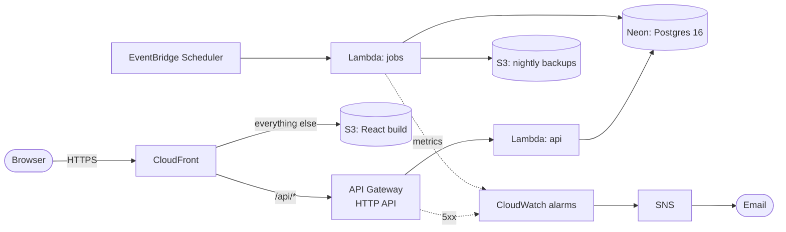
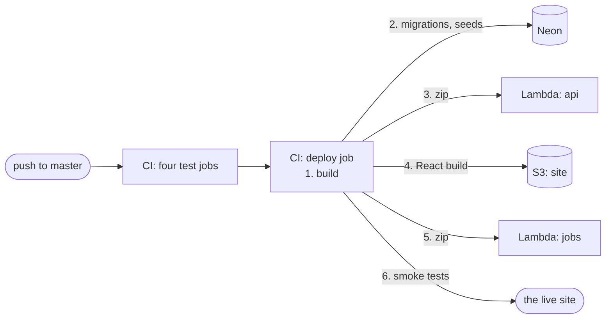

# Cloud (AWS + Neon)

The site runs serverless on AWS, in `eu-north-1` (Stockholm), with the database on
[Neon](https://neon.com), a hosted Postgres 16 in Frankfurt. Every AWS resource is in Terraform, in
[infra/](../infra/); Neon, the secrets and Terraform's own state bucket were set up by hand, once.

**Live:** https://d2r41mkrvtiz2x.cloudfront.net

## Architecture



Both functions read their secrets from SSM Parameter Store when they start; the deploy is drawn
[below](#deploying).

- **A page view**: CloudFront serves the React files from S3, and sends `/api/*` to API Gateway,
  which runs the FastAPI app on Lambda ([api/lambda_handler.py](../api/lambda_handler.py)). The page
  and the API share one origin, so the session cookie needs no CORS, as with Vite's proxy locally.
- **Collection**: EventBridge Scheduler invokes the `jobs` function
  ([etl/lambda_jobs.py](../etl/lambda_jobs.py)) with the job to run. The schedule is in
  [etl.md](etl.md) ("The schedule").
- **Both functions run one zip** ([scripts/build_lambda.sh](../scripts/build_lambda.sh)): the code
  and its dependencies, built for Lambda's Linux, with different handlers.

## Why each service

| Service | What it does here | Why this one |
|---|---|---|
| **Lambda** | Runs the API (1024 MB, 15 s) and the jobs (512 MB, 15 min) | Paid per request and inside the free tier; nothing runs while nobody visits |
| **API Gateway** (HTTP API) | The API's HTTPS entry, with throttling: 10 requests a second, bursts of 20 | A Lambda function URL has no throttling, the guard against a flood and a surprise bill |
| **CloudFront** | HTTPS, the React files, and `/api/*` on the same address | Free certificate on its own `*.cloudfront.net` address; 1 TB a month free |
| **S3** | The React build (private, readable only by CloudFront) and the nightly backups | Static files; a backup costs ~710 KB |
| **EventBridge Scheduler** | Invokes the jobs, on Israel time | Always on: the laptop cron it replaced silently never fired one night in July 2026 |
| **SSM Parameter Store** | The secrets, as `SecureString`s | Free; Secrets Manager is $0.40 per secret a month |
| **CloudWatch + SNS** | Logs (kept 14 days), six alarms, their emails | Built in; the jobs report metrics as a log line, with no extra API call |
| **Neon** | The database | Suspends when idle, so it costs $0, and it's plain Postgres: only `DB_URL` changed. The smallest RDS instance runs all the time, ~$12–15 a month |

**Not used**: a VPC (Lambda outside one reaches Neon, Travelpayouts and SerpApi directly; inside a
private one it would need a NAT Gateway, ~$33 a month), Docker or ECR (a zip is enough), and a cache
in front of the API (measured and not worth it at this traffic: [api.md](api.md#known-limitations)).

## What it costs

| Item | Per month |
|---|---|
| Lambda, API Gateway, CloudFront, S3, Scheduler, CloudWatch, SNS, SSM | ~$0–0.10, inside the free tiers |
| Neon | $0 (past its limits the free plan pauses; it never bills) |
| **Total** | **$0 out of pocket** |

The account is on AWS's Free plan: $100 in credits, until 2027-04-20, with no card on file, so
nothing can be charged. An AWS Budget (`monthly-5-usd`, counting usage before credits) emails at
$4 and $5. The alarms stay within CloudWatch's free 10 alarms and 10 custom metrics.

## Secrets and access

- **Secrets** go into SSM by hand (`aws ssm put-parameter --type SecureString`), never through
  Terraform, which writes everything it creates into its state. Each function reads only its own
  path, `/vacation-budget/api/` or `/vacation-budget/jobs/`, loaded once per cold start: after
  changing one, give the functions fresh environments (change their description, then change it
  back). The API gets Neon's pooled connection string, the jobs its direct one.
- **Each function has its own role**, allowed only what it does: write its own logs, read its own
  secrets, and, for `jobs`, write to the backups bucket (not read or delete, so a bug can't destroy
  a backup).
- **Terraform's state** is in a versioned S3 bucket created by hand, with S3-native locking. Its
  name holds the account id, so it's in the gitignored `infra/backend.hcl`; the alarms' email
  address is in the gitignored `infra/terraform.tfvars`.
- **The deploy's access** is described below.

## Deploying

A push to `master` deploys itself: CI's `deploy` job runs after the four test jobs pass
([testing.md](testing.md#ci-githubworkflowsciyml)). It runs
[scripts/deploy.sh](../scripts/deploy.sh), which also works from a laptop (a clean tree, `aws login`,
`terraform init` done):



1. **Build** the zip and the React app, before anything ships, so a type error can't leave a new
   API behind the old site.
2. **Migrations and seed data on Neon.** A failing migration stops the deploy with the old code still
   live. The old code then runs against the new schema for a moment, so a migration only adds:
   dropping a column the running code reads takes two deploys.
3. **The `api` function**, checked to run the zip just built (`CodeSha256`).
4. **The site**: the hashed assets first, cached for a year; then `index.html` with `no-cache`, so a
   deploy shows on the next reload without invalidating CloudFront.
5. **The `jobs` function**, last, since no visitor sees it.
6. **Smoke tests** ([scripts/smoke_test.sh](../scripts/smoke_test.sh)): health, a search, an inner
   page on refresh.

**CI's AWS access** is an access key of the IAM user `vacation-budget-deploy`
([infra/deploy.tf](../infra/deploy.tf)), allowed only to update both functions' code, write to the
site bucket and read the jobs' `DB_URL`. The key is a secret of the GitHub environment `production`,
which hands it only to runs on `master`. OIDC (short-lived credentials, no stored key) was the
plan, but this account type's organization policy, managed by AWS, forbids creating an OIDC
provider.

Terraform owns the resources and their settings, and ignores the functions' code after creating
them: `terraform apply` never ships code, and `deploy.sh` never changes a setting.

## Backups

Every night at 05:30, after collection, the `backup` job writes each table as a gzipped CSV
(`COPY ... TO STDOUT`) to `backups/<date>/<table>.csv.gz` in the backups bucket: nine files. Data
only, since the schema is in git as migrations. The bucket is private and versioned, and a backup
expires after 90 days.

Neon has its own point-in-time restore, but on the free plan its window is short, and it's the same
provider: S3 covers a mistake noticed a week later, or a problem with the Neon account.

**Restoring** ([etl/backup/restore.py](../etl/backup/restore.py)), into an empty database: it runs
the migrations, loads every table in foreign-key order, and resets each id sequence.

```bash
aws s3 cp --recursive s3://<backups bucket>/backups/<date>/ /tmp/backup
DB_URL=<the target database> uv run python -m etl.backup.restore /tmp/backup
```

The data loads all or nothing, but the migrations commit first: after a failed load, drop the schema
before trying again. The same script refreshes the local development database with the cloud's
data. A backup from before a migration that drops or renames a column needs the code from its date.

## Alerts

Every alarm emails through the SNS topic `vacation-budget-alerts`
([infra/alarms.tf](../infra/alarms.tf)). What each one means, and where to look:

| Alarm | Fires when | First place to look |
|---|---|---|
| `job-failed` | A job raised or timed out (Lambda's `Errors`) | The traceback, in `/aws/lambda/vacation-budget-jobs` |
| `api-5xx` | The API answered 5xx (API Gateway counts them: to Lambda, a FastAPI 500 is a success) | `/aws/lambda/vacation-budget-api`; a database error usually means Neon or its `DB_URL` |
| `flights-inserted-nothing` | A flights run saved 0 rows | Its summary line: many request errors mean the Travelpayouts token or API; none mean no new prices |
| `hotels-updated-nothing` | A hotels run updated 0 cities | Its summary line: the SerpApi key or quota |
| `no-flights-run` | No flights run reported in 25 hours | The schedules, then the function's log |
| `no-backup` | No backup completed in 25 hours | The backup's log; `job-failed` usually fired too |

The last two also email when they're back to OK, since there OK means a run reported again. They
look back 25 hours, not 24, because the schedules are on Israel time and the night the clocks go
back the runs are 25 hours apart. A failed run isn't retried, by the function or the schedule: a
second hotels run would spend the SerpApi quota twice.

## Known limitations

- **The first visit after a quiet spell waits about 3 seconds**, while Lambda starts and Neon wakes
  ([api.md](api.md#known-limitations)).
- **The deploy key is long-lived.** It can only ship code, but whoever holds it can ship code to
  the functions, which reach the database. It's rotated by hand (`aws iam create-access-key`, the
  new one into the environment's secrets, then `delete-access-key` on the old one).
- **No own domain.** One needs the Paid plan or an outside registrar, and possibly a certificate
  outside the project's region, which this account type may forbid.
- **The Free plan ends on 2027-04-20.** With no card on file, AWS then suspends the account and
  erases it 90 days later unless it's upgraded. Neon is separate and stays.
- **One region, chosen by AWS.** This account type pins the project to `eu-north-1`; Neon has no
  Stockholm region, so each query crosses to Frankfurt (~20–25 ms).
