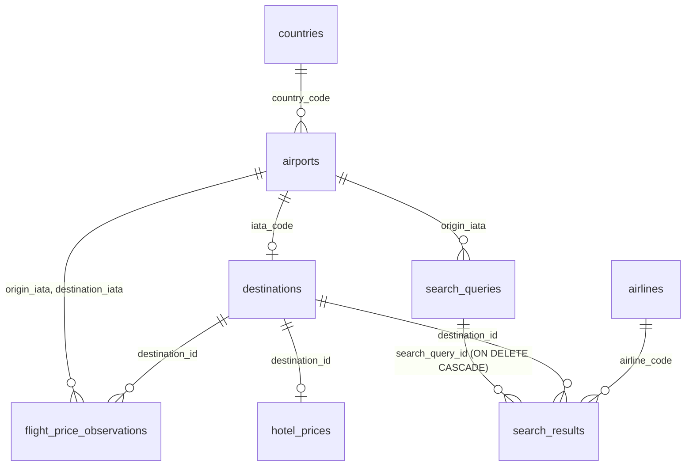

# Database

PostgreSQL 16, written in raw SQL with no ORM. The schema is built by the numbered files in
[sql/migrations/](../sql/migrations/), and all the SQL the API runs is in
[app/queries.py](../app/queries.py).

## The tables

The nine tables fall into four groups:

| Group | Tables | Holds |
|---|---|---|
| Reference | `countries`, `airports`, `airlines`, `exchange_rates` | Facts about the world, keyed by real-world codes |
| Crosswalk | `destinations` | The 103 places the app prices |
| Prices | `flight_price_observations`, `hotel_prices` | What the collectors fetched |
| App usage | `search_queries`, `search_results` | Searches people ran, and what they were shown |

### Reference tables

These are keyed by codes that already exist in the outside world, so the outside APIs' answers
need no translation: `ES` for a country, `BCN` for an airport, `IZ` for an airline.

- **`countries`**: an ISO country code, plus its name in English and Hebrew.
- **`airports`**: an IATA airport code, its name, city, country (FK to `countries`), and coordinates.
- **`airlines`**: an IATA airline code and its display name (`IZ` is Arkia), loaded from
  Travelpayouts' public airline list.
- **`exchange_rates`**: how many US dollars one unit of ILS, EUR or USD is worth, and the date of
  that rate. Every price in the database is stored in USD. This table converts a budget the user
  enters in shekels or euros.

### `destinations`: the crosswalk

The two price sources identify places differently. Flights come keyed by airport code (`BCN`),
and the hotel search is queried by city name (`"Barcelona hotels"`). There is no shared
identifier, so each destination is curated by hand once, in
[sql/seed/destinations_seed.csv](../sql/seed/destinations_seed.csv), and gets an internal
`destination_id` that everything else references.

| Column | Purpose |
|---|---|
| `destination_id` | The internal id. A surrogate key, because "destination" is this app's concept, not the world's: if a city's airport changed, the id and everything that points at it would stay |
| `city_name` | The English name, used for the hotel search. Unique: one destination per city |
| `city_name_he` | The Hebrew name shown in the interface. Nullable, and the interface falls back to the English name |
| `iata_code` | The airport, used for the flight search. Unique, with an FK to `airports` |
| `is_active` | Turns a destination off without deleting the rows that reference it |

A destination's country is its airport's (`destinations.iata_code → airports.country_code`). It
isn't stored a second time, so there is no second copy to fall out of sync.

To add a destination, add a row to the seed CSV and rerun `load_destinations_seed`. The
collectors pick it up on their next run.

### `flight_price_observations`: append-only

One row means *a price we saw for one round trip*: TLV to a destination, on a departure and a
return date, with an airline, a number of stops, local departure and return times, and a price.

Rows are never updated or deleted by the collector. When a price changes, a new row is added.
Keeping every observation is what lets a search find the nearest available dates, and shows how a
price moved over time.

Two dates say when a row was seen:

- **`price_seen_on`**: the day a real Aviasales user saw this price. Travelpayouts is a cache of
  other people's searches, which keeps a quote for about a week, so the same quote comes back on
  every collector run that week. This date is what tells a new price from one already stored. It's
  required (`NOT NULL`), and a result that doesn't carry one isn't stored.
- **`observed_at`**: when our collector fetched the row. It feeds the per-day collection chart, and
  it's the record of when a collection run actually happened.

**The duplicate rule** is `uq_flight_obs`: the same flight (destination, dates, airline, stops,
times) at the same price, seen on the same day, is stored once. The insert uses
`ON CONFLICT DO NOTHING`, so a collector run adds only what it hasn't seen. The constraint is
`NULLS NOT DISTINCT`: in plain SQL `NULL = NULL` isn't true, so without it two rows that both lack
an airline would never count as duplicates.

**`source`** records which code path wrote the row:

- `'collector'`: a month-wide query, which returns the cheapest round trip per date pair.
- `'live_search'`: a user opening a destination's page, which asks for their exact dates and
  stores every option.

The two are counted apart in the collection chart, and a `CHECK` allows only these two values.

### `hotel_prices`: one snapshot per destination

`destination_id` is both the primary key and an FK. Each collector run overwrites a destination's
row (`INSERT ... ON CONFLICT (destination_id) DO UPDATE`) instead of adding history, because
SerpApi's free tier allows 250 searches a month. That is enough to refresh each destination a
couple of times a month, not to keep daily snapshots.

From the ~20 hotels a search returns, a row keeps three nightly prices:

- **average**: the mean of the whole sample;
- **budget**: the mean of the cheapest 10, or of the cheaper half when the sample has fewer
  than 20;
- **luxury**: the mean of the priciest 10, or of the pricier half.

Along with these, a row keeps the minimum price, the sample size, and `loaded_at`, so the
interface can show how old a price is.

The prices are nullable on purpose. A sample too small to split into tiers stores `NULL`, which
the interface shows as a missing price. A zero would make the hotel look free and send that city to
the top of the ranking.

The price is for a fixed stay (7 nights from tomorrow), not the dates a user searches, since a live
hotel search per user search would use up the monthly quota.

### `search_queries` and `search_results`

| Table | One row is | Holds |
|---|---|---|
| `search_queries` | One search a user ran | Origin, dates, budget and currency, hotel tier, travelers, rooms, and whether the results were exact-date matches |
| `search_results` | One destination in that search's results | Flight, hotel and total estimate in USD, whether it fit the budget, and the airline |

- **History without accounts.** `session_id` is a random UUID kept in a cookie for 30 days from
  the last visit. A browser's history shows only its own searches, and another browser's search
  id returns 404, even though ids are sequential.
- **Frozen values.** Results are stored as they were at search time. Opening a saved search shows
  what was shown then, not a recalculation on today's prices. The rank isn't stored: it's computed
  from the frozen totals when read (`RANK() OVER (ORDER BY estimated_total_usd)`).
- **Only the chosen tier is saved.** A search computes all three hotel tiers so the interface can
  switch between them, but only the one the user picked is written.
- **`ON DELETE CASCADE`.** Deleting a search deletes its results.
- **Rules the database enforces:**
  - the return comes after the departure, and the budget is positive;
  - 1–9 travelers and 1–9 rooms, and no more rooms than travelers;
  - the hotel tier is one of `budget`, `average` or `luxury`.

Opening a single destination's page isn't saved as a search. It has no budget or ranking to
store; its live flight results go to `flight_price_observations` instead.

## Integrity: what the database enforces

The database checks its own data rather than trusting the code that writes it:

- **Foreign keys** for every reference that must exist: a flight's destination and airports, a
  hotel price's destination, a result's search. There is one deliberate exception:
  `flight_price_observations.airline_code` has no FK. A flight from an airline missing from the
  reference list is still stored, and shows its raw code. `search_results.airline_code` does have
  an FK, and its insert stores `NULL` for an unknown code.
- **`CHECK`s** for every value with a valid range: prices above zero, the return after the
  departure, the known `source` and tier values, and the traveler and room limits.
- **`NULL` means unknown, never zero.** A missing hotel price or a missing flight is a `NULL` that
  queries surface as missing data (`LEFT JOIN`s plus `flight_data_missing` and
  `hotel_data_missing` flags), never a cost of zero.

## Indexes

Every primary key and unique constraint has its own index. Beyond those there are only two:

| Index | Used by |
|---|---|
| `idx_flight_obs_depart_date` | The estimate query, which looks for flights within ±4 days of the requested departure. The condition is written as a plain `BETWEEN` so the index can be used |
| `idx_search_results_query` | Opening a saved search: all the results of one search |

`uq_flight_obs` leads with `destination_id`, so it also serves per-destination lookups, such as
the data-quality page's flight count per destination, with no extra index.

Indexes are added only when `EXPLAIN ANALYZE` shows a query needs one. On the small tables
(`destinations`, `airports`, `search_queries`), Postgres scans the whole table faster than it
could use an index. And every index on the flight table slows down each of the thousands of
inserts in a collector run.

## Changing the schema

Migrations are plain SQL files numbered in order. `run_migrations` records each file it applies
in `schema_migrations`, and runs only the files not recorded there, each in its own transaction.

- To change the schema, **add a new numbered file**. Never edit one that has already run: only
  the file name is tracked, so the edit would never reach a database that already applied it.
- The tests build a fresh database from the migrations and seed files on every run, and so does
  CI, so a broken migration fails there before it reaches anyone else's database.

## Cleanup

Three scripts in [etl/loaders/](../etl/loaders/) keep the tables bounded. For now they are run by
hand:

| Script | Deletes |
|---|---|
| `cleanup_old_flights` | Flights whose return date is more than 3 months past |
| `cleanup_old_hotels` | Hotel prices not refreshed in 3 months: the destination shows a missing hotel price until it's collected again |
| `cleanup_old_searches` | Searches older than 30 days, the session cookie's lifetime: no browser can open them anymore |
